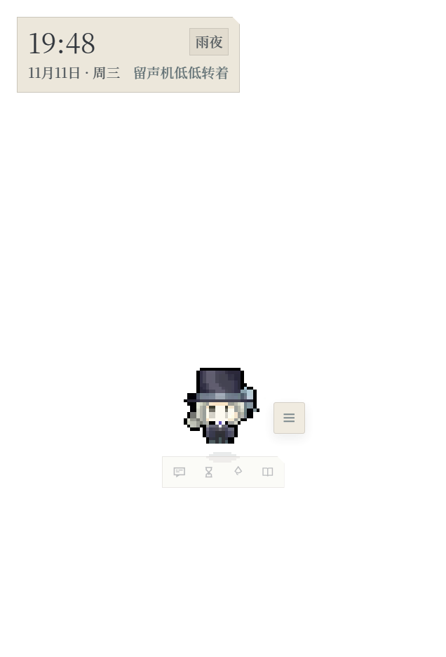
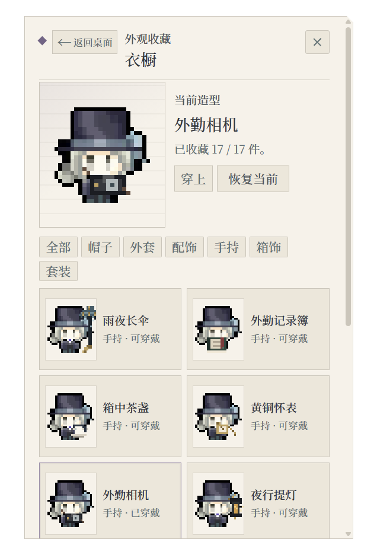

# 维尔汀 · 雨夜书桌

以《重返未来：1999》的维尔汀为灵感制作的 Windows 像素桌宠。可以把她拖到桌面一角，点帽子打招呼、聊几句、开一段专注计时，或者在休息时拾雨、翻看箱中档案。

 

[查看牙仙的人物档案预览](preview/dossier.png)

## 直接使用便携版

Windows 便携版解压即可运行，无需安装 Node.js 或 npm。[下载便携版 v1.1.0](https://github.com/WBbbbbbb103/vertin-deskpet/releases/download/v1.1.0/VertinPet-portable-1.1.0.zip)

1. 把 ZIP 完整解压到你有写入权限的文件夹。
2. 双击 `VertinPet.exe`。
3. 首次启动会显示三步桌面引导：拖动、菜单、找不到时如何召回。

便携版的数据保存在 `VertinPet.exe` 旁边的 `userdata` 文件夹；换电脑时连同整个文件夹一起复制。不要把含有 `llm-config.json` 的 `userdata` 发给别人。

首次运行时如果 Windows 弹出「Windows 已保护你的电脑」，点「更多信息」→「仍要运行」即可。这是未签名应用第一次运行的 SmartScreen 提示。

## Windows 源码安装教程

### 1. 安装 Node.js

打开 [Node.js 下载页](https://nodejs.org/en/download)，下载 Windows 安装程序（`.msi`）。本项目使用的 Electron 需要 **Node.js 22.12.0 或更高版本**。安装时保留默认组件，包含 npm 和添加到 PATH 的选项。

装好后重新打开 PowerShell，运行下面两个命令检查版本号。

```powershell
node --version
npm.cmd --version
```

### 2. 下载并解压项目

在 GitHub 仓库页面点击绿色 **Code → Download ZIP**。右键 ZIP，选择「全部解压缩」，然后打开解压后的 `vertin-deskpet-main` 文件夹。看到 `package.json`、`package-lock.json`、`Start-Vertin.bat` 和 `assets` 文件夹后，就到了正确的位置。 [GitHub 下载源码说明](https://docs.github.com/en/repositories/working-with-files/using-files/downloading-source-code-archives)

如果电脑已经安装 Git，也可以在 PowerShell 中克隆仓库。

```powershell
git clone https://github.com/WBbbbbbb103/vertin-deskpet.git
cd vertin-deskpet
```

### 3. 安装依赖并首次启动

在项目文件夹的资源管理器地址栏输入 `powershell`，按回车。接着依次运行下面两条命令。

```powershell
npm.cmd ci --include=dev
npm.cmd start
```

等第一条命令完成再运行第二条。第一次启动可能会下载 Electron 运行文件，请保持联网。看到桌面上的维尔汀或系统托盘里的桌宠图标后，安装就完成了。之后可以双击同目录下的 `Start-Vertin.bat`。 [npm 安装命令说明](https://docs.npmjs.com/cli/v11/commands/npm-ci/) · [Electron 下载说明](https://www.electronjs.org/docs/latest/tutorial/installation)

### 4. 显示、隐藏和退出

- 拖动维尔汀可以调整桌面位置。点击角色、右键角色或点击旁边的菜单按钮，可以打开对话和功能入口。
- 按 `Ctrl + Shift + V` 可以显示或隐藏桌宠。也可以在任务栏右下角右键点击桌宠图标，选择「请维尔汀出来」。找不到图标时，点托盘旁的上箭头查看隐藏的图标。
- 关闭面板或隐藏桌宠后，应用仍会在后台运行。需要结束运行时，从托盘菜单选择「退出桌宠」。

启动时，桌宠会检查上次保存的左右位置，避免换显示器或调分辨率后跑出屏幕右边缘。重新显示时，应用会再检查窗口位置。桌宠已在运行时，再双击启动脚本或快捷方式也能把她唤回。

## 可以做什么

| 操作 | 功能 |
| --- | --- |
| 点击头部、帽子或身体 | 摸头、整理礼帽或闲聊 |
| `C` | 打开聊天输入框；未配置 DeepSeek 时使用离线台词 |
| `F` | 打开番茄钟，可选 15 到 120 分钟专注、短休或长休 |
| `G` / `P` | 开始 20 秒拾雨，游戏中暂停或继续。结算显示最高连击和连击加成 |
| `R` | 打开旧日记录，可阅读 148 位角色的桌边内容和 32 份深度人物档案。进入「箱中档案」可搜索国服 4.1 的 139 个可玩角色条目和 27 个剧情人物条目 |
| `W` | 打开衣橱，试穿、换装和查看解锁条件 |
| `S` | 打开设置，调整角色大小、音效、置顶、语言和主动发言频率 |
| `Esc` | 关闭当前对话、菜单或面板 |

通过「更多 → 角色资料」可以看今日陪伴、等级轨迹和累积记录。陪伴等级最高为 Lv.30，衣橱有 17 件外观，包括蓝石领巾、外勤相机、箱侧合影和夜行提灯。中英文界面可以在设置中切换。

点击头部、帽子、身体和旧箱子会结合专注状态、手持物、当前造型、最近来客和连续点击给出不同短句，并避开最近三条。

## 番茄钟、记忆、签到、衣橱与照片

[查看 120 分钟专注预览](preview/focus-120.png) · [查看音乐盒预览](preview/musicbox-final.png)

- **番茄钟**：专注 / 短休 / 长休三种模式，25 分钟专注后默认 5 分钟短休；每完成 4 段专注进入 15 分钟长休并重置轮次。支持 15/25/45/60/90/120 分钟专注、5/10 分钟短休、15/20 分钟长休、自动进入下一段、任务标签、今日段数/分钟和累计专注，并增加最近 7 天柱状图与最长连续专注天数。系统托盘可直接暂停、继续或跳过当前阶段。完成一段专注仍获得 +8 亲密与 +2 时之雨。

- **记忆确认**：DeepSeek 回复里如果出现值得记住的稳定事实，气泡下方会出现「记住 / 修改 / 忽略」。记忆分为偏好、正在做、重要日期和其他四类，最多 20 条、置顶 3 条；只有确认后才保存在本机。聊天时只注入与当前话题相关的已确认内容，置顶记忆优先。每 12 轮回复保存一条本地对话摘要，可在设置中查看和删除。设置里另有 12 个固定离线对话自检场景。
- **每日签到**：角色下方常用快捷条、右侧工具条、右键菜单、角色资料或菜单红点进入。每个本地自然日可签到一次，奖励亲密度（等级经验）和时之雨；**奖励每 7 天循环一次**，连续天数继续累计，断签从新的连续天数开始。签到面板显示最近 7 天历史，并在连续第 7/14/28 天获得纪念卡，不新增货币。
- **衣橱**：17 件外观，支持 3 套造型预设、试穿、筛选和等级解锁。相机在 Lv.17 解锁，箱侧合影在 Lv.20 解锁。
- **照片册**：需要先解锁相机（Lv.17）并实际拍过照片，才会有内容。相机每拍一次保存日期、头衔和当时的像素造型，最多 12 张；箱侧合影、角色资料或右键菜单可以翻阅和删除。照片册不会保存真实截图。
- **箱中来客**：Lv.5 解锁桌面手提箱，点击随机召见一位来客。目前有十三位：十四行诗、37、远旅、伊索尔德、鹭鸶剪、梁月、蓝手帕、兔毛手袋、天使娜娜、塞梅尔维斯、洛伦兹蝴蝶、玛丽安娜、卡戎。首次召见 +2 亲密度，重复 +1，并记录在「箱中来客」收藏里。立绘保留 2D 图片，并加入呼吸、轻晃、入场和点击回应；点击角色卡可以再看立绘，打开对应人物档案。角色图片和方案见 [docs/suitcase-summon-plan.md](docs/suitcase-summon-plan.md)。
- **音乐盒**：Lv.8 解锁箱边的小发条音乐盒。最后一张像素图作为封面，首批三首本地原创纯音乐循环：雨落在箱上、翻页、直到雨停。支持播放/暂停、上一首/下一首、音量、循环和 15/30/60 分钟睡眠定时；关闭面板后继续播放，不自动播放。方案与实现说明见 [docs/music-box-plan.md](docs/music-box-plan.md)。

## 可选配置 DeepSeek 聊天

离线模式可以直接聊天。想让模型生成回复时，按以下步骤设置。

1. 在 [DeepSeek 开放平台](https://platform.deepseek.com/api_keys) 创建自己的 API Key。
2. 按 `S` 打开桌宠设置，找到「DeepSeek 连接」，填入 Key。接口默认是 `https://api.deepseek.com`，模型默认是 `deepseek-chat`。
3. 点击「保存」，再点击「测试连接」。测试成功后，勾选「用 DeepSeek 生成聊天回复」并保存。
4. 按 `C` 试发一句话。请求失败或超时时，桌宠会使用本地台词。

启用后，聊天内容和生成回复所需的少量角色资料、已确认记忆或陪伴记录会发往你配置的接口，调用费用由对应账号承担。Key 通过 Windows 系统加密保存在本机。陪伴记录、最近话题和记忆可以在设置里关闭或清空。

## 更新与备份

- 从 ZIP 安装时，下载新版并解压到新目录，按安装步骤重新运行。用 Git 安装时，先从托盘退出桌宠，再执行 `git pull` 和 `npm.cmd ci --include=dev`。
- 默认优先沿用已有的用户数据目录，通常是 `%APPDATA%\VertinDeskPet`。如果应用在项目目录使用了 `userdata`，更新前请备份该目录。可以在资源管理器地址栏输入 `%APPDATA%\VertinDeskPet`，查看其中是否有 `startup.log`。
- 若以前用的是便携版，数据可能在原便携版文件夹的 `userdata` 里。退出旧版后再备份。迁移到另一台电脑后，建议重新填写 DeepSeek Key，系统加密的旧 Key 可能无法解开。

## 常见问题

| 现象 | 处理方法 |
| --- | --- |
| 找不到 `node` 或 `npm.cmd` | 安装 Node.js 后重开终端。仍找不到时，检查安装时是否将 Node.js 加入 PATH。 |
| PowerShell 提示禁止运行 `npm.ps1` | 用教程里的 `npm.cmd` 运行命令。 |
| `npm` 提示找不到 `package.json` | 检查当前目录是否是解压后含 `package.json` 的那一层。 |
| 双击脚本提示缺少 Electron | 先按第 3 步安装依赖并用 `npm.cmd start` 完成首次启动。 |
| 首次启动下载失败或超时 | 检查网络是否能访问 npm 仓库和 GitHub。恢复连接后再次运行 `npm.cmd start`。 |
| 托盘有图标，但桌宠跑出了屏幕 | 右键托盘图标，选「回到屏幕右下角」。如果菜单显示「请维尔汀出来」，先点它把桌宠显示出来。也可以按 `Ctrl + Shift + V` 隐藏后再按一次唤回。 |
| DeepSeek 测试失败 | 检查 Key、接口地址、模型名、账号额度和网络。保存后再测一次。 |

如果浏览器能通过本机代理访问 GitHub，但 Electron 下载仍超时，可让当前 PowerShell 窗口沿用代理。将示例中的地址和端口改成自己正在使用的 HTTP 代理，再重新启动。 [Electron 代理配置说明](https://www.electronjs.org/docs/latest/tutorial/installation#proxies)

```powershell
$env:HTTPS_PROXY = 'http://127.0.0.1:7897'
$env:HTTP_PROXY = $env:HTTPS_PROXY
$env:ELECTRON_GET_USE_PROXY = '1'
npm.cmd start
```

## 项目结构与素材

- `main.js` 和 `preload.js` 管理桌宠窗口、托盘、数据目录与聊天请求。
- `renderer/` 包含像素场景、互动、衣橱、专注计时、拾雨和角色档案。
- `assets/` 包含随应用载入的像素素材、图标和字体。

这是非商业同人项目。《重返未来：1999》及维尔汀角色版权归深蓝互动（Bluepoch）所有。桌宠中的同人对话与旧日记录包含原创演绎。思源宋体由 Adobe 发布，随仓库附带 [SIL Open Font License 1.1](assets/fonts/OFL-SourceHanSerif.txt) 和 [版权说明](assets/fonts/NOTICE-SourceHanSerif.txt)。
